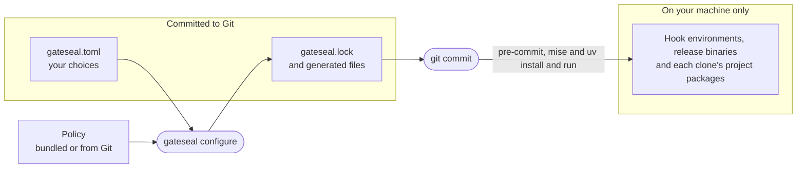
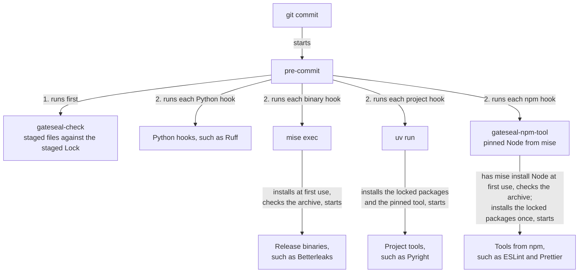

# How gateseal works

A team policy gives repositories a reviewed set of checks. Each repository selects a release in `gateseal.toml`, its Manifest. The generated `gateseal.lock`, or Lock, records the selection and generated files. Each repository can move to a new policy release when it is ready.

For example, this Manifest fragment selects the bundled Python checks:

```toml
capabilities = ["hygiene", "python"]
```

After an edit, `gateseal configure` writes the Lock and the pre-commit configuration. If enabled, it also writes a GitHub Actions workflow or an Azure Pipelines file. See [Adjust a setup](adjust-a-setup.md).



## How the policy, Manifest and Lock connect

The policy offers capabilities and choices. The Manifest selects one release of the policy by its Git tag and commit, and picks from the offer. `gateseal configure` reads both and writes the Lock and the generated files. You write the Manifest. gateseal writes the Lock.

These excerpts are cut down to the lines that link the three files. See [Policy format](policy-format.md#example) and [Manifest and Lock](policy-contract.md#example) for the full examples. A word in a comment names one fact that the files share. The same word in two files means the lines belong together. For example, `skip` is the policy allowing a skip and the Manifest using it. The list below the files explains each word.

`policy.toml`, in the team's policy repository, tagged `team-2026.11`:

```toml
release = "team-2026.11"                      # release: label of this policy version

[capabilities.hygiene]
optional = ["check-yaml"]                     # skip: a repository may skip this

[capabilities.python.tools.ruff]
pin = "0.17.5"                                # pin: tool version to use

[capabilities.python.choices]
target_version = "py311"                      # default: a repository may change it
```

`gateseal.toml`, the Manifest, in the repository that adopts the policy:

```toml
[policy]
repository = "https://github.com/team/gateseal-policy.git"
commit = "3f2a9c1d5e7b4a60918c2d4e6f8a0b1c3d5e7f90"   # commit: exact policy version
tag = "team-2026.11"                          # tag: Git tag that names the commit

[choices.hygiene]
skip = ["check-yaml"]                         # skip: allowed by the policy

[choices.python]
target_version = "py312"                      # default: replaced by this value
```

`gateseal.lock`, the Lock, which `gateseal configure` writes:

```jsonc
{
  "policy": {
    "release": "team-2026.11",                           // release
    "commit": "3f2a9c1d5e7b4a60918c2d4e6f8a0b1c3d5e7f90", // commit
    "tag": "team-2026.11",                               // tag
    "digest": "sha256:acafb1dd…"
  },
  "choices": {
    "hygiene": { "skip": ["check-yaml"] },               // skip
    "python": { "target_version": "py312" }              // default, as replaced
  },
  "components": {
    "ruff": { "version": "0.17.5", "revision": "ef6cf06c…" }  // pin
  }
}
```

- `release`: the policy names its release. The Lock records that label.
- `skip`: the policy lists which hooks are optional. The Manifest may skip only those. `check-yaml` then no longer appears in the Lock's `hook_ids`.
- `pin`: the policy pins the tool version. The Lock records that version with the exact upstream revision.
- `default`: the policy sets a default for a choice. The Manifest can change it. The Lock records the final value.
- `tag`: the Manifest names the Git tag that points to the commit. gateseal checks this when you adopt the policy. The tag name does not have to equal the release label.
- `commit`: the commit pins the exact policy files. The Lock records the same commit and a digest of their content.

## What the checks trust



The first commit hook compares staged generated files with the staged Lock. When it fails, pre-commit runs no other hook. CI checks the policy and generated files before running checks. Hook repositories use full Git commit IDs, so a moved tag cannot change the selected commit. mise checks release archives against their SHA-256 when it downloads them on a machine or in CI. The CI job and `gateseal fetch` make these downloads before the first hook runs.

A policy can request an installed executable check at commit time. The bundled Betterleaks definition enables it. `gateseal run` and the CI gate do not recheck cached executables. The Lock pins direct inputs. It does not freeze every transitive dependency. Ruff's hook installs a version-pinned PyPI package without a locked wheel hash, and so do the hooks of Pyright, coverage.py, pytestmut, deptry, and uv's lockfile check and audit. A tool from npm, such as ESLint, installs the npm packages that `policy.lock` records with their integrity hashes, on a Node archive whose SHA-256 the Lock records. Pyright and deptry run in the repository's uv project, where the repository's `uv.lock` pins the packages that they read. gateseal stops when `uv.lock` installs a package with a tool's name and pinned version from the project's own source. `tsc` reads the packages that the repository's npm or pnpm lockfile pins, which gateseal's hook installs without install scripts. That install obeys the npm and pnpm settings of the project and the user, in `.npmrc`, `pnpm-workspace.yaml` and the environment, such as the registry and `omit=dev`. A setting can leave out a package or stop the push, but cannot make the push pass with other packages than the lockfile pins. Tools run with the permissions of the user who starts them. Git, pre-commit, mise, uv, the host, and the policy's authors must be trusted.

A local user can bypass hooks with `git commit --no-verify`. A repository administrator can require the CI check before merging. See [the CI gate](ci-gate.md) for event scopes, and [GitHub CI](github-ci.md) or [Azure Pipelines](azure-pipelines.md) for the setup and private policy access.

## Alternatives and costs

For one or two repositories, a pre-commit configuration and a CI job that runs `pre-commit run --all-files` cover most needs. gateseal adds policy releases, drift checks, and pinned release binaries across repositories. A copy script or an agent can copy configuration once, but it does not check for later drift.

The team maintains a policy repository and adds a Manifest and Lock to each repository. The first use of a hook needs network access to install dependencies. A private policy needs Git read access when gateseal fetches it. See [Adopt a team policy](adopt-a-team-policy.md).
