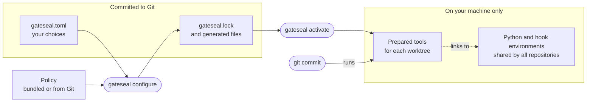

# How gateseal fits into a repository

A team can use one policy across repositories without making every repository
upgrade at once. Each repository chooses a policy release in `gateseal.toml`.
Its committed `gateseal.lock` records the tools and generated files that a
reviewer can expect from that choice.

## Each part has one owner

| Who | Responsibility |
| --- | --- |
| Policy author | Writes the team's policy: the tools, their versions, and the rules. Lists the other versions they also tested, and the settings a repository may change. Tags each release. |
| Repository maintainer | Writes one repository's `gateseal.toml`: the policy release, the capabilities, values for the allowed settings, and any switch to another tested version. Reviews `gateseal.lock` and the generated files before committing them. |
| gateseal | Compiles the Manifest, prepares the locked tools, installs the Git hook, and detects changes to files it owns. |
| Git | Fetches a team policy with the user's Git configuration and credentials. Selects the index for each commit. |
| uv | Downloads and verifies the compiler runtime and builds the compiler and pre-commit environments. |
| pre-commit | Prepares Python hook environments and runs the selected hooks. |
| mise | Downloads and verifies release binaries such as Betterleaks during activation. |

One person can hold both roles. They stay separate because one policy can
serve many repositories, and each repository upgrades when it is ready.

## What you review in Git

A policy can ship with the compiler or come from a team's Git repository.
When a repository first adopts a Git release, gateseal checks that the release
tag names the selected commit. The Lock records the commit and a digest of the
policy. Later commands use the recorded content, even if someone moves the tag.
See [Policy acquisition](policy-acquisition.md).

A policy groups tools into capabilities. For example, selecting `python` in the
bundled policy adds Ruff. A policy can offer a choice of formatters or several
reviewed versions of a tool. The Lock records the selected hooks, versions, and
settings. A team can define another tool using a kind that the compiler
supports. Its definition names the source, hooks, probes, and arguments.
See [Policy format](policy-format.md) and [Tool definitions](tool-definitions.md).

`gateseal configure` writes the Lock and the native configuration that tools
read. You can review those files with an ordinary Git diff. If you edit a
generated file, configure reports an ownership conflict. Change the Manifest
or the policy to change a check. See [Manifest and Lock](policy-contract.md).

## What gateseal promises

- It never overwrites a file or a Git hook that it did not write. It stops
  instead.
- It stops if Git would run another hook first or instead, for example
  from a custom `core.hooksPath`.
- `configure` checks every path before it writes and replaces each file in
  one step. The files together are not one transaction. If `configure`
  stops partway, run it again to finish.
- `activate` installs exactly the versions that the Lock pins. `configure`
  takes each tool's version from the Manifest and its policy release, so a
  version changes only when you change the Manifest.

## What stays on the machine

`gateseal activate` prepares the locked compiler and tools for one worktree.
The worktrees of a repository share an installed Git hook. Each worktree has
its own current preparation. The machine's interpreter store holds the Python
interpreters and hook environments that worktrees can reuse.
See [How a commit runs](how-a-commit-runs.md).

The compiler release fixes CPython and pre-commit. A policy can also pin a
[Hook Python](policy-format.md#hook-python) for Python-language hooks. For
example, a formatter can then parse syntax newer than the compiler's Python.
To change pre-commit itself, [upgrade the compiler](upgrade.md#compiler-targets).

## What gateseal trusts

The Lock lets gateseal detect changes to the policy, generated files, and
prepared tools. The host OS, Git, local preparation, and the tools that
perform installation must be trustworthy. A person who can replace the local
hook can also bypass its checks.

- A matching Git tag and content digest identify a release. You still need
  to trust the team that controls the policy repository.
- The compiler wheel, runtime archives, and runtime wheels have locked
  SHA-256 values. An upgrade runs the candidate compiler after verifying
  its wheel.
- Python hook repositories have locked Git revisions. pre-commit installs
  their dependencies using the configured package index and local caches.
  For example, the Ruff hook pins the Ruff package by version. Its wheel
  has no locked hash. Activation and `gateseal doctor` check the installed
  executable's version.
- Tools run with the access of the user who starts them. Review a
  team-defined tool's arguments as well as its source. For example, the
  built-in Betterleaks definition disables repository ignore files. Another
  scanner's behavior depends on its definition.

## What CI checks

With GitHub CI enabled, configure generates a workflow that installs the
pinned compiler and activates the repository on a runner. The CI gate runs
hooks on the files selected for the event. If a tool defines a history scan,
the gate also checks the commits in the event. This can catch a secret added
and then removed before review. See [GitHub CI](github-ci.md).

[Design record 0008](design/0008-generate-the-ci-gate-as-an-owned-workflow.md)
explains why the repository commits the generated workflow and reviews changes
to it alongside the Lock.

## Key decisions

Each decision has a cost. Its design record gives the full reasons, and the
[design records](design/README.md) list every decision.

- **Policies are data, not code.** A policy selects tools, versions, and
  rules. It cannot add scripts or plugins, so a reviewer reads data. The
  cost is that a new kind of tool needs a gateseal release.
  [Design record 0007](design/0007-implement-tool-kinds-in-the-compiler-and-describe-every-tool-as-data.md)
- **Tools are ready before the commit.** `gateseal activate` installs every
  tool. Commits then run only the prepared tools and start neither uv nor
  mise. The cost is one `activate` in each worktree, and again when the Lock
  changes.
  [Design record 0003](design/0003-prepare-gateseal-tools-before-commits.md)
- **Each release ships its own Python and pre-commit.** Every machine and
  every CI run uses the same versions. The cost is that a new pre-commit
  needs a gateseal upgrade.
  [Design record 0006](design/0006-generate-policy-lock-data-and-ship-the-runtime-with-the-compiler.md)
- **A team policy release is an exact commit.** The Lock records the commit
  and a digest of the policy, so a moved tag changes nothing. The cost is
  that each worktree fetches the release once, with network access and Git
  credentials.
  [Design record 0004](design/0004-acquire-git-policy-releases-by-exact-commit.md)
- **Repositories share installs.** Each Python and each hook environment is
  installed once per machine, named by the SHA-256 of its archive or recipe.
  A new worktree adds no hook environment to disk. The cost is shared state.
  If one repository rebuilds a shared environment, another worktree must run
  `gateseal activate` again before its next commit. Each shared install is
  sealed, and activation takes a lock while it writes one.
  [Design record 0010](design/0010-share-one-sealed-interpreter-store-across-repositories.md),
  [design record 0011](design/0011-share-sealed-hook-environments-through-the-interpreter-store.md)

## How the design is tested

- **Real commits.** The integration tests run the installed `gateseal`
  command with real Git, uv, pre-commit, and check tools, in clones and
  linked worktrees. See [What the tests prove](what-the-tests-prove.md).
- **Mutation testing.** On each pull request that changes the code, a check
  makes small wrong changes to the changed lines, such as `>` to `>=`. The
  check fails if no unit test notices one.
- **CRAP scores.** Every function must score 10 or less. The score rises
  when complex code has few tests.
- **A TLA+ model.** It checks every order of activation, cleanup, and commit
  steps within its bounds. It shows that they keep five of the
  [prepared attempt invariants](local-preparation.md#prepared-attempt-invariants).

[Build and verify gateseal](verification.md) shows how to run each check.
