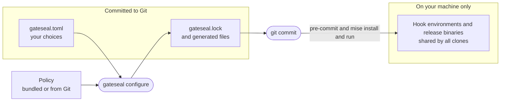
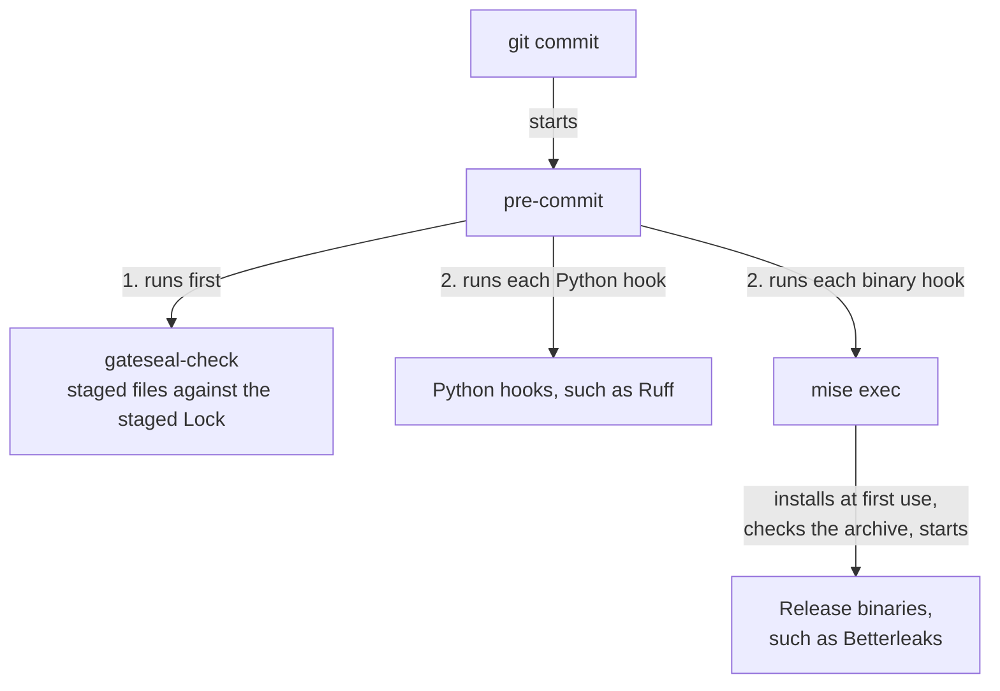

# How gateseal works

A team policy gives repositories a reviewed set of checks. Each repository selects a release in `gateseal.toml`, its Manifest. The generated `gateseal.lock`, or Lock, records the selection and generated files. Each repository can move to a new policy release when it is ready.

For example, this Manifest fragment selects the bundled Python checks:

```toml
capabilities = ["hygiene", "python"]
```

After an edit, `gateseal configure` writes the Lock and the pre-commit configuration. If enabled, it also writes a GitHub Actions workflow. See [Adjust a setup](adjust-a-setup.md).



## What the checks trust



The first commit hook compares staged generated files with the staged Lock. CI checks the policy and generated files before running checks. Hook repositories use full Git commit IDs, so a moved tag cannot change the selected commit. mise checks release archives against their SHA-256 when it downloads them on a machine or in CI.

A policy can request an installed executable check at commit time. The bundled Betterleaks definition enables it. `gateseal run` and the CI gate do not recheck cached executables. Ruff's hook installs a version-pinned PyPI package without a locked wheel hash. Tools run with the permissions of the user who starts them. Git, pre-commit, mise, the host, and the policy's authors must be trusted.

A local user can bypass hooks with `git commit --no-verify`. A repository administrator can require the GitHub CI check before merging. See [GitHub CI](github-ci.md) for event scopes and private policy access.

## Alternatives and costs

For one or two repositories, a pre-commit configuration and a CI job that runs `pre-commit run --all-files` cover most needs. gateseal adds policy releases, drift checks, and pinned release binaries across repositories. A copy script or an agent can copy configuration once, but it does not check for later drift.

The team maintains a policy repository and adds a Manifest and Lock to each repository. The first use of a hook needs network access to install dependencies. A private policy needs Git read access when gateseal fetches it. See [Adopt a team policy](adopt-a-team-policy.md).
