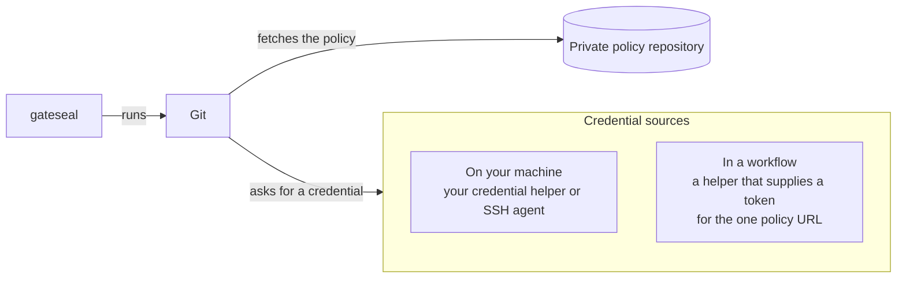

# Authenticate to a private policy

Give Git read access to the private repository that holds your team's policy.
gateseal runs Git to fetch the release and stores no credentials.

## Give Git access to a team policy

Use your credential helper or SSH agent on your machine. In GitHub Actions,
give the job a token scoped to the policy repository. The
[policy acquisition reference](policy-acquisition.md) describes the fetch.



### On your machine

Replace the example URL with the policy URL from your manifest. Check that
Git lists the release tag.

```sh
git ls-remote --tags https://github.com/team/gateseal-policy.git
```

Git uses your credential helper, SSH agent, and `url.<base>.insteadOf`
rewrites. If the helper opens a browser or asks for a password, sign in
during this check. gateseal runs Git without a terminal and sets
`GCM_INTERACTIVE=never`.

### In a GitHub Actions workflow

If you use the generated workflow, set the `GATESEAL_POLICY_TOKEN` secret.
See [Give the job read access](github-ci.md#give-the-job-read-access).

For your own workflow, the job's `GITHUB_TOKEN` can read only the workflow's
repository. Give the job access to the private policy as follows.

1. Store a token with read access to the policy repository in a workflow
   secret. Pass it as `POLICY_TOKEN` to the step that fetches the policy.
2. Use the policy URL from the base branch. A pull request can change the
   URL in its own manifest.
3. Configure a Git credential helper for that exact URL. Replace the example
   URL with yours.

```sh
git config --global credential.useHttpPath true
git config --global credential.https://github.com/team/gateseal-policy.git.helper \
  '!f() { test "$1" = get && echo username=x-access-token && echo "password=$POLICY_TOKEN"; }; f'
```

The single quotes leave the token in the environment until Git calls the
helper. With `credential.useHttpPath`, Git matches the repository path as
well as the host. Credentials persisted by `actions/checkout` belong to the
checked-out repository. The temporary Git repository that gateseal uses for
the policy fetch has its own configuration.
