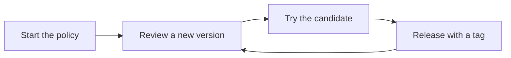

# Author a team policy

Keep your team's checks in a Git repository and tag the commits that other
repositories can adopt. You choose the rules and review each tool version.
gateseal records the upstream commits, archive URLs, and checksums in
`policy.lock`.

Use Git and the gateseal release your repositories use. The `policy add`
and `policy lock` commands need network access to the tool repositories
and release downloads.



## Start the policy

1. Create a Git repository and copy the bundled policy into a new or empty
   `policy/` directory.

    ```sh
    git init -b main team-gateseal-policy
    cd team-gateseal-policy
    gateseal policy init policy
    ```

2. In `policy/policy.toml`, set `release` to a label such as
   `"team-2026.11"`. The label can contain up to 128 printable characters.
   The `[capabilities]` tables group the tools. The `[tools]` tables select
   their hooks and rule files. Keep the required `hygiene` capability.

3. If you remove a capability, remove its tool and component tables, version
   tables, and choices. For example, if you remove `python`, also delete
   `[choices.python.target_version]`. To remove `secrets`, remove
   `[capabilities.secrets]`, `[tools.betterleaks]`, `[components.betterleaks]`,
   its version tables, and `rules/betterleaks.toml`. Run
   `gateseal policy lock policy` to drop those versions from the lock.

4. Edit the remaining rule files under `policy/rules/`. Use UTF-8 TOML with
   LF line endings. A rule file cannot extend another configuration.
   To add a tool of your own, see [Add a tool](add-a-tool.md).

5. Check the policy and commit it so you can review future changes with Git.

    ```sh
    gateseal policy check policy
    git add policy
    git commit -m "Start team policy"
    ```

`policy/README.md` contains instructions for the next author.
The [policy format](policy-format.md) describes the fields you can edit.

## Review a new version

1. Read the tool's release notes. Choose the exact released version you want
   to review. This example adds Betterleaks 1.8.1 for a team that uses
   the 1.8 series. Substitute the release your team wants to review.

2. Add the version to the policy.

    ```sh
    gateseal policy add betterleaks 1.8.1 policy
    ```

    gateseal checks each reviewed version against upstream. For a binary,
    it downloads each new archive and verifies the published checksum before
    it writes `policy.toml` and `policy.lock`.

3. If the version requires a minimum version of another tool, add that
   requirement to its version table. For example, `requires = { ruff = "0.17.1" }`
   requires Ruff 0.17.1 or later.

4. Review `git diff -- policy`. Look for the version table in `policy.toml`
   and the matching record in `policy.lock`. To make this version the
   default for repositories that adopt your policy, pin it.

    ```sh
    gateseal policy pin betterleaks 1.8.1 policy
    gateseal policy check policy
    ```

A pin must name a reviewed version and meet the other pins' requirements.
The previous version stays available through a Version Exception. To remove
a reviewed version, move its pin first if necessary. Delete the version table
and run `gateseal policy lock policy`.

Add and pin preserve comments and table order. If the command reports
`policy_edit_unsupported`, make the change by hand. Run `gateseal policy
lock policy` after adding a version or `gateseal policy check policy`
after changing a pin. See the [Policy Lock reference](policy-lock.md).

## Automate a version bump

A scheduled workflow or Renovate can propose a version in a pull request.
Give the job access to GitHub and pass it the exact version from the release
you want to review. For example, the job can run these commands.

```sh
gateseal policy add betterleaks 1.8.1 policy
gateseal policy pin betterleaks 1.8.1 policy
gateseal policy check policy
```

If `policy add` exits 4, check upstream access and retry the same command.
If it exits 2 with an `upstream_` code, investigate the missing or changed
release data. Review the release notes and both policy files before merging.
Then [test the candidate](#try-a-candidate-policy-before-you-tag-it) and
[tag the release](#release-the-policy).

## Handle a fact that upstream changed

If a release tag moves or a published checksum changes, `policy lock`
reports `upstream_changed`, the affected version, and both values.
Investigate the change with the publisher. A replaced archive or tag can
indicate tampering.

If you approve the replacement, delete `policy/policy.lock`, then run
`gateseal policy lock policy`. gateseal resolves all reviewed versions and
downloads the archives again. Review every change in `git diff -- policy/policy.lock`
before you commit.

## Try a candidate policy before you tag it

Test a candidate with a local tag and a disposable consumer repository. Keep
the candidate tag and the consumer repository on your machine.

1. In the policy repository, commit your changes and tag the commit you want
   to test. If the changes are already committed, start with the tag command.

    ```sh
    git add policy
    git commit -m "Prepare team-2026.11"
    git tag candidate-team-2026.11
    ```

2. From the root of a disposable Git repository that does not use gateseal
   yet, select the candidate. First copy the wheel's URL and SHA-256, as
   [Pin the wheel on PyPI](install.md#pin-the-wheel-on-pypi) shows.
   Substitute your policy repository's real HTTPS URL and local absolute path
   below. The Git rewrite applies only to this command.

    ```sh
    GIT_CONFIG_COUNT=1 \
    GIT_CONFIG_KEY_0="url.file://$HOME/src/team-gateseal-policy.insteadOf" \
    GIT_CONFIG_VALUE_0=https://github.com/team/gateseal-policy.git \
    gateseal configure --capability hygiene --capability secrets \
      --policy https://github.com/team/gateseal-policy.git \
      --policy-path policy --policy-tag candidate-team-2026.11 \
      --compiler-source PYPI_WHEEL_URL --compiler-sha256 WHEEL_SHA256
    ```

    Select only capabilities you kept in the policy. gateseal checks the
    local tag, commit, and policy lock. The consumer manifest records the
    real URL with the local candidate tag.

3. In the consumer repository, run `gateseal activate`. Review and stage
   the generated files with a sample change. Run `git commit` to test the
   checks a contributor will run.

4. Remove the disposable consumer repository. In the policy repository, run
   `git tag -d candidate-team-2026.11` to remove the local test tag.

## Release the policy

1. From the policy repository, run the offline check.

    ```sh
    gateseal policy check policy
    ```

2. Make sure the policy files you tested are committed and that `HEAD` is
   the release commit. With `origin` set to your team's repository and
   `main` as the release branch, publish the tag.

    ```sh
    git tag -a team-2026.11 -m "Release team-2026.11"
    git push origin main team-2026.11
    ```

3. Give repository maintainers the repository URL, policy path, and release
   tag. They can now [adopt the release](adopt-a-team-policy.md). Their
   repositories stay on the reviewed commit until they select another release.
