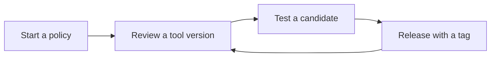

# Author a team policy

Create a Git repository for the reviewed checks that other repositories can adopt. Use the gateseal release that those repositories use. The `policy add` and `policy lock` commands need network access to upstream releases.



## Start a policy

Create a repository and copy the bundled policy into a new directory:

```sh
git init -b main team-gateseal-policy
cd team-gateseal-policy
gateseal policy init policy
```

See the [example policy](policy-format.md#example) first. Edit the `release` label in `policy/policy.toml`. Edit its capabilities, tool versions, and rule files for your team. See [Policy format](policy-format.md) for field rules and [Add a tool](add-a-tool.md) for complete examples.

The bundled `rules/betterleaks.toml` starts from the rules built into Betterleaks. To change the secret rules, edit that file:

- Add a `[[rules]]` table to find a secret of your own.
- Add a rule ID to `disabledRules` to turn off a rule that finds too much, such as `generic-password`.
- Add an `[[allowlists]]` table to skip paths, such as test fixtures.

```toml
[[rules]]
id = "team-service-token"
description = "Team service token"
regex = '''\bteam_[A-Za-z0-9]{32}\b'''
keywords = ["team_"]

[[allowlists]]
description = "Test fixtures"
paths = ['''(?:^|/)tests/fixtures/''']
```

The file's own rules fill gaps in the built-in ones. Its top-level `filter` replaces the filter built into Betterleaks, which drops findings that look like placeholders. A new Betterleaks version can change its built-in rules and filter, so review them when you review the version.

If you remove a capability, remove its tables and rule files. Run `gateseal policy lock policy` after changing reviewed versions or tools. The generated `policy.lock` records the reviewed upstream commits and archive checksums. Check the policy. Then commit it:

```sh
gateseal policy check policy
git add policy
git commit -m 'Start team policy'
```

## Review a tool version

Read the tool's release notes and choose an exact release. For example, to review a Betterleaks release newer than the bundled 1.10.1 in the bundled policy copy, run the commands below. Replace `<version>` with the release you chose.

```sh
gateseal policy add betterleaks <version> policy
gateseal policy pin betterleaks <version> policy
gateseal policy check policy
```

The first command checks the reviewed releases against upstream and updates `policy.lock`. The second selects the reviewed version as the default. Review both files before committing. To remove a reviewed version, move its pin first if necessary. Remove it from `reviewed` and any `requires` entry. Run `gateseal policy lock policy`.

If a tag or checksum changed upstream, `policy lock` reports `upstream_changed`. Investigate the change before accepting it. If you approve it, delete `policy/policy.lock`. Regenerate it and review every change before committing. See [Policy lock](policy-format.md#policy-lock) for errors.

## Test a candidate

Commit the policy changes. In the policy repository, create a local candidate tag:

```sh
git tag candidate-team-2026.11
```

Create a disposable Git repository for the consumer. From its root, run the following command. Replace `$HOME/src/team-gateseal-policy` with the absolute path to your policy repository. Replace the example URL with its real HTTPS URL. The Git rewrite applies only to this command.

```sh
GIT_CONFIG_COUNT=1 \
GIT_CONFIG_KEY_0="url.file://$HOME/src/team-gateseal-policy.insteadOf" \
GIT_CONFIG_VALUE_0=https://github.com/team/gateseal-policy.git \
gateseal configure --capability hygiene \
  --policy https://github.com/team/gateseal-policy.git \
  --policy-path policy --policy-tag candidate-team-2026.11
```

Select a capability in your policy. Review and stage the generated files. Make a test commit. Delete the disposable consumer when finished. In the policy repository, delete the local candidate tag with `git tag -d candidate-team-2026.11`.

## Release the policy

In the policy repository, check the committed policy and publish a tag. Replace the example branch and tag with your team's names:

```sh
gateseal policy check policy
git tag -a team-2026.11 -m 'Release team-2026.11'
git push origin main team-2026.11
```

Give repository maintainers the URL, policy directory, and tag. They can [adopt the release](adopt-a-team-policy.md). A consumer stays on its selected commit until it adopts another release.
