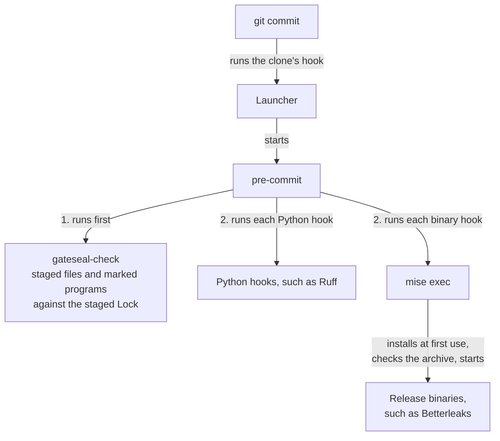

# How a commit runs

When you run `git commit`, Git starts pre-commit's commit launcher. pre-commit
runs the hooks of `.pre-commit-config.yaml` on the files you staged.
`gateseal configure` generates that file from the Lock, and its first hook is
gateseal's own check.

## Before the commit

`gateseal setup` installs pre-commit and makes Git copy pre-commit's commit
launcher into every new clone. In a clone that you made before setup,
`gateseal setup --refresh` adds it. See
[Set up pre-commit on this machine](install.md#set-up-pre-commit-on-this-machine).

The first commit that needs a hook downloads it, so it needs network access:

- pre-commit clones each hook repository at the revision that the
  configuration pins, gateseal's own among them. It installs each one with its
  Python packages, such as the Ruff wheel.
- mise downloads each release binary, such as Betterleaks, and checks its
  archive's SHA-256.

Later commits in every clone on the machine reuse them. The first commit after
a Lock change downloads only what changed.

## During the commit

1. Git starts the launcher, which starts pre-commit on the staged files.
2. The `gateseal-check` hook runs the gateseal that the Lock pins. It compares
   the staged Manifest and generated files with the SHA-256 values in the
   staged Lock. For each tool whose definition sets `check_at_commit`, such as
   Betterleaks, it also compares the program that mise installed with the
   Lock. It needs no network and no policy.
3. The other hooks check the staged files. Each release binary starts through
   `mise exec`.

If a commit stops, follow its next step.
[When a commit stops](work-in-a-configured-repository.md#when-a-commit-stops)
lists the common causes.

## Which files run

An ordinary commit checks the staged content of the files it changes.
`git commit -a`, a path-specific commit, and a commit with `GIT_INDEX_FILE`
use the index Git chose for that operation. pre-commit temporarily saves
unstaged edits to partially staged source files and restores them after the
checks. If a hook fixes a file, review and stage the fix before retrying.
See [Work in a configured repository](work-in-a-configured-repository.md).
