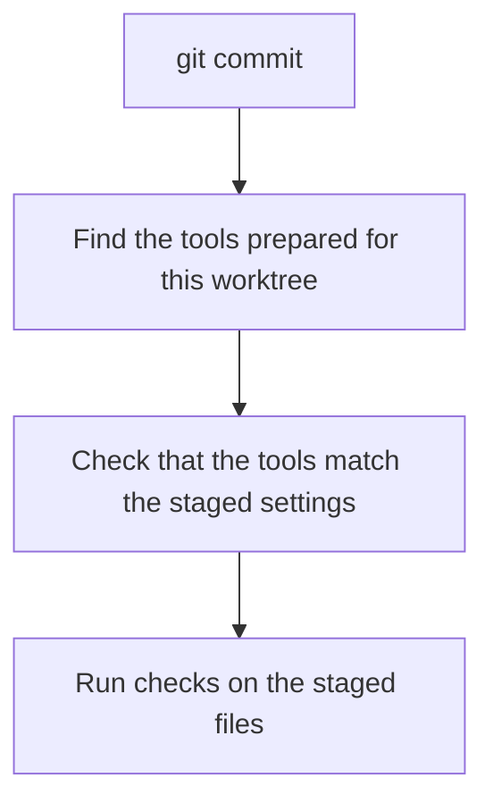

# How a commit runs

When you run `git commit`, Git tells gateseal which files you staged.
The staged copy of `gateseal.lock` selects the tools for the commit.
gateseal checks that those tools are ready in this worktree before it
starts pre-commit.

## Before the commit

`gateseal activate` builds a *prepared attempt* in the worktree's Git
directory. It installs tools or links to copies in the machine's interpreter
store. It writes the local record last. When preparation and hook installation
succeed, it changes the `current` link to point to the complete attempt. If
preparation fails, the previous attempt stays current.

The Git hook is shared by the worktrees of a repository. The hook follows
`current` in the worktree making the commit. A new, moved, or copied worktree
needs its own activation. See [Local preparation](local-preparation.md).

## During the commit

1. The hook resolves `current` and starts the bootstrap with the prepared
   Python. The commit uses that attempt until pre-commit exits.
2. The bootstrap checks the worktree location, staged Lock, and generated
   files. Each staged generated file must match its working copy because
   the tools open the working copy. The bootstrap also checks the prepared
   files and hook executables.
3. The prepared compiler reads the exact staged blobs that the bootstrap
   checked. It verifies that the staged Manifest, Lock, and generated files
   agree.
4. The compiler starts pre-commit on Git's terminal. You see the hook
   output as it runs. Git receives pre-commit's exit status, and Ctrl-C
   reaches pre-commit while it restores unstaged edits.

Each stage replaces the previous process. The hook uses the prepared tools,
so commits can run with a minimal `PATH` and without starting uv or mise.

## Which files run

An ordinary commit checks the staged content of the files it changes.
`git commit -a`, a path-specific commit, and a commit with `GIT_INDEX_FILE`
use the index Git chose for that operation. pre-commit temporarily saves
unstaged edits to partially staged source files and restores them after the
checks. If a hook fixes a file, review and stage the fix before retrying.
See [Work in a configured repository](work-in-a-configured-repository.md).

## How each command checks the prepared tools

| Operation | What it checks |
| --- | --- |
| Commit, `gateseal status`, `gateseal run` | File metadata in the prepared trees and the expected hook executables. A commit also validates the staged inputs. |
| `gateseal doctor` | File contents by hash and health probes for the selected tools. It can detect damage that preserves size and modification time. |
| `gateseal activate` | File contents and tool health. It prepares a new attempt when repair is necessary. |

If a commit stops before any check runs, follow its next step. When the
working copy matches the staged Manifest and Lock, activation can prepare
them. Otherwise, the message identifies which files to stage or restore.
See [Staged Lock selection](local-preparation.md#staged-lock-selection).
