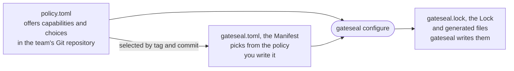

# Policy format

A policy directory contains `policy.toml`, its rule files, optional tool definitions, and generated `policy.lock`. To create a complete policy from the bundled example, run this in a directory without a `policy/` entry:

```sh
gateseal policy init policy
```

See [Author a team policy](author-a-policy.md) for editing and release steps. A repository selects a policy in `gateseal.toml`, its Manifest. The generated `gateseal.lock`, or Lock, records that selection and generated files.

## Example

This small policy offers three capabilities. Repositories choose from them. The comments say what each part does.

<!-- policy tables: team -->
```toml
schema = 5
release = "team-2026.11"
minimum_compiler = "0.1.0"

# Capability "hygiene": file checks. A repository may skip check-yaml.
[capabilities.hygiene]
optional = ["check-yaml"]

[capabilities.hygiene.tools.pre-commit-hooks]
hook_ids = ["trailing-whitespace", "end-of-file-fixer", "check-yaml"]
pin = "6.0.0"                # the version repositories use
reviewed = ["6.0.0", "5.0.0"] # versions the team has checked

[capabilities.hygiene.choices]
exclude = []                 # repositories may list paths to skip
skip = []                    # repositories may list optional hooks to skip

# Capability "python": Ruff with the team's rules in rules/ruff.toml.
[capabilities.python.tools.ruff]
hook_ids = ["ruff-check", "ruff-format"]
configuration = "rules/ruff.toml"
pin = "0.17.1"
reviewed = ["0.17.1"]

[capabilities.python.choices]
target_version = "py311"     # default that a repository may change

# Capability "secrets": Betterleaks with the team's rules.
[capabilities.secrets.tools.betterleaks]
configuration = "rules/betterleaks.toml"
pin = "1.9.0"
reviewed = ["1.9.0", "1.8.0"]
```

A repository selects this policy in its Manifest. [Manifest and Lock](policy-contract.md#example) shows the matching Manifest.



The same fields, cut down to the lines that link the three files. A word in a comment names one fact that the files share. The same word in two files means the lines belong together. For example, `skip` is the policy allowing a skip and the Manifest using it. The list below the files explains each word.

`policy.toml`, in the team's policy repository, tagged `team-2026.11`:

```toml
release = "team-2026.11"                      # release: label of this policy version

[capabilities.hygiene]
optional = ["check-yaml"]                     # skip: a repository may skip this

[capabilities.python.tools.ruff]
pin = "0.17.1"                                # pin: tool version to use

[capabilities.python.choices]
target_version = "py311"                      # default: a repository may change it
```

`gateseal.toml`, the Manifest, in the repository that adopts the policy:

```toml
[policy]
repository = "https://github.com/team/gateseal-policy.git"
commit = "3f2a9c1d5e7b4a60918c2d4e6f8a0b1c3d5e7f90"   # commit: exact policy version
tag = "team-2026.11"                          # tag: Git tag that names the commit

[choices.hygiene]
skip = ["check-yaml"]                         # skip: allowed by the policy

[choices.python]
target_version = "py312"                      # default: replaced by this value
```

`gateseal.lock`, the Lock, which `gateseal configure` writes:

```jsonc
{
  "policy": {
    "release": "team-2026.11",                           // release
    "commit": "3f2a9c1d5e7b4a60918c2d4e6f8a0b1c3d5e7f90", // commit
    "tag": "team-2026.11",                               // tag
    "digest": "sha256:acafb1dd…"
  },
  "choices": {
    "hygiene": { "skip": ["check-yaml"] },               // skip
    "python": { "target_version": "py312" }              // default, as replaced
  },
  "components": {
    "ruff": { "version": "0.17.1", "revision": "38bfb07c…" }  // pin
  }
}
```

- `release`: the policy names its release. The Lock records that label.
- `skip`: the policy lists which hooks are optional. The Manifest may skip only those. `check-yaml` then no longer appears in the Lock's `hook_ids`.
- `pin`: the policy pins the tool version. The Lock records that version with the exact upstream revision.
- `default`: the policy sets a default for a choice. The Manifest can change it. The Lock records the final value.
- `tag`: the Manifest names the Git tag that points to the commit. gateseal checks this when you adopt the policy. The tag name does not have to equal the release label.
- `commit`: the commit pins the exact policy files. The Lock records the same commit and a digest of their content.

## Policy fields

`policy.toml` uses schema `5`. It needs a printable `release` label of at most 128 characters and `minimum_compiler` in `major.minor.patch` form. It needs at least one capability and one tool per capability. Tools and capabilities run in file order.

Optional `time_budget_seconds` sets the CI gate's [time budget](github-ci.md#time-budget) in whole seconds, such as `300` for five minutes. A slower gate warns but never fails.

| Field under `capabilities.<name>` | Meaning |
| --- | --- |
| `tools.<tool>.hook_ids` | Optional ordered, distinct hook IDs. Omit it for every hook in definition order. |
| `tools.<tool>.configuration` | Relative path under `rules/`. Required when the tool definition declares a configuration. |
| `tools.<tool>.pin` | Default version, which must be reviewed. |
| `tools.<tool>.reviewed` | Distinct reviewed versions in `major.minor.patch` form. |
| `tools.<tool>.requires.<version>` | Optional map of other tools to minimum versions. |
| `alternatives.<choice>` | Two or more distinct hooks that offer one choice. |
| `optional` | Distinct hooks the repository may skip. |
| `choices.<choice>` | Exposed choice and its default. |

Capability and tool names match `[a-z][a-z0-9-]*`, and choice names match `[a-z][a-z0-9_]*`. gateseal checks the schema and minimum compiler before other fields. A mismatch gives `unsupported_schema` or `incompatible_compiler`. The compiler supplies definitions for `pre-commit-hooks`, `ruff`, and `betterleaks`. Other definitions belong in `tools/<name>.toml`; see [Tool definitions](tool-definitions.md). A missing definition gives `unknown_tool`. A reserved name gives `reserved_tool_name`. Duplicate hooks, names, outputs, or tool assignments give `duplicate_identifier`.

### Alternatives

This fragment offers two formatters defined by the policy:

<!-- policy tables: alternatives -->
```toml
[capabilities.python.alternatives]
formatter = ["ruff-format", "black"]

[capabilities.python.choices]
formatter = "ruff-format"
```

Only the chosen hook runs. An alternative must name at least two distinct hooks and have a default. A hook cannot appear in multiple alternatives or be optional. An unknown hook gives `unsupported_hook`, a hook in more than one alternative gives `duplicate_identifier`, and a name that conflicts with a tool or compiler choice gives `invalid_field`. An invalid default gives `invalid_field` or `invalid_choice`. See [Add a tool](add-a-tool.md#offer-black-as-a-formatter) for a complete example.

### Optional hooks

This fragment lets a repository skip `check-yaml`:

<!-- policy tables: optional -->
```toml
[capabilities.hygiene]
optional = ["check-yaml"]

[capabilities.hygiene.choices]
exclude = []
skip = []
```

The `skip` default is empty. A repository can skip only a hook named in `optional`. A missing `skip` default gives `invalid_field`. Exposing `skip` without optional hooks gives `unsupported_choice`. If no hook remains for a tool, gateseal omits its generated files and Lock entry. A version exception for that tool gives `unused_exception`.

### Choices and rules

A policy can expose a tool's declared choice, an alternative, `skip`, or `exclude`. `exclude` skips paths for the entire capability. A capability with a history scan cannot expose `exclude`. A rule file cannot set a key that the policy exposes as a choice.

Rule files use UTF-8 TOML and LF line endings. They must be regular, non-executable files under distinct relative paths. Path segments use lowercase letters, digits, dots, underscores, and hyphens. A segment cannot be `.` or `..`. A Betterleaks or Gitleaks rule file can have an `extend` table with only `useDefault` and `disabledRules`. It then starts from the rules built into the tool and turns off the rules that `disabledRules` names. Any other `extend` is invalid, because it could load another file.

Each release is flat. The keys `extends`, `extend`, `inherit`, `include`, and `base` give `policy_inheritance`. A pin must be reviewed and meet the other selected tools' requirements. Incompatible pins give `incompatible_policy`.

## Policy lock

`policy.lock` is generated JSON. It records the upstream Git commit or archive URL and SHA-256 for each reviewed version. `gateseal policy check` validates the file offline. `gateseal policy lock` and `gateseal policy add` check upstream data and download new archives before writing. An executable marked `check_at_commit` also gets an executable SHA-256.

| Code | Meaning |
| --- | --- |
| `policy_lock_missing`, `policy_lock_stale`, `policy_lock_unreviewed`, `policy_lock_edited` | The file is missing or does not agree with the policy. Run `gateseal policy lock`. |
| `upstream_changed` | A recorded tag or checksum changed. Investigate before accepting it. |
| `upstream_tag_missing`, `upstream_asset_missing`, `upstream_checksum_missing` | The expected upstream release data is missing. |
| `upstream_checksum_mismatch`, `upstream_executable_missing` | The downloaded archive failed verification or lacks the expected executable. |
| `upstream_unavailable` | Git or an HTTPS download failed. Check access. Retry. |
| `policy_changed` | A policy file changed during the operation. Review it. Retry. |
| `invalid_invocation`, `unknown_component`, `version_unreviewed`, `requires_conflict`, `policy_edit_unsupported` | Check the component, reviewed version, requirements, or TOML layout in the diagnostic. |

See [Author a team policy](author-a-policy.md#review-a-tool-version) for review and recovery steps.

## Policy digest

The digest is a fingerprint of all policy files: `policy.toml`, the named rule files, the named tool definitions, and `policy.lock`. The same content always gives the same digest. Any change to these files, such as an edit or a new, removed or renamed file, gives a new digest. The digest identifies the content. It does not prove who published it.

The digest is a SHA-256 over each file's path and content, in path order. For the exact byte format, see `content_stream` in [`policy.py`](https://github.com/karstenevers/gateseal/blob/main/src/gateseal/policy.py).
